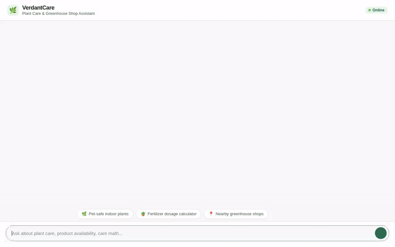

# VerdantCare — Plant Care & Greenhouse Shop Assistant



**VerdantCare** is an agentic AI assistant designed to help plant enthusiasts, greenhouse shoppers, and garden managers. Built using the **Google Agent Development Kit (ADK)** and powered by **Gemini 2.5 Flash**, VerdantCare combines real-time database queries, botanical classification APIs, multimodal media generation (images & time-lapse videos), location services, allergy-aware memory retention, and rich structured UI rendering (**A2UI v0.8**).

---

## 🌟 Key Features & Capabilities

Based on the implemented toolset in `app/tools.py` and `app/agent.py`:

- **Greenhouse Catalog Search & Management**:
  - `search_plants`: Search and filter plants in Firestore by category (*Tropical, Succulent, Indoor Tree, Flowering*) and maximum price.
  - `get_plant_details`: Fetch full item specifications (care level, watering schedule, light requirements, price, stock quantity).
  - `add_or_update_plant`: Dynamically update greenhouse inventory records.

- **Plant Health Diagnostics & Botanical Taxonomy**:
  - `diagnose_plant_health`: Rule-based diagnostic evaluator that analyzes symptoms (yellowing leaves, brown spots, drooping, pests) to recommend care treatments.
  - `lookup_botanical_taxonomy`: Queries the GBIF Botanical Species API (or Perenual API) for scientific classification (kingdom, family, genus, species).

- **Multimodal Image & Video Generation**:
  - `generate_plant_image`: Generates realistic plant catalog photographs using `gemini-3.1-flash-lite-image` in the `global` region, saving artifacts locally and uploading to Google Cloud Storage.
  - `generate_plant_video`: Generates short time-lapse videos using Google's Omni model (`gemini-omni-flash-preview` via the Interactions API) in the `global` region and uploads MP4 files to Cloud Storage.

- **Location Services**:
  - `geocode_address`: Converts human-readable addresses to geographic coordinates using the Google Maps Geocoding API.
  - `find_nearby_places`: Searches for nearby florists, plant nurseries, and garden centers using the Google Places API (New).

- **Persistent Memory Bank**:
  - Integrated with **Vertex AI Memory Bank Service** (`VertexAiMemoryBankService`) to remember and enforce user preferences, plant allergies, and health sensitivities across chat sessions.

- **Rich Structured UI (A2UI v0.8)**:
  - Generates lightweight, responsive UI cards (Cards, Text, Images, Rows) via an `after_model_callback` for structured responses in the frontend.

- **Code Execution Sandbox**:
  - Runs calculations and Python snippets safely using `AgentEngineSandboxCodeExecutor`.

---

## 🛠️ Google Cloud & Architecture Integration

- **Google Agent Development Kit (ADK)**: Core agent framework (`google.adk`).
- **Gemini 2.5 Flash (`gemini-2.5-flash`)**: Primary reasoning LLM.
- **Vertex AI Agent Engine / Memory Bank**: Long-term memory store.
- **Google Cloud Firestore**: NoSQL inventory database for greenhouse items.
- **Google Cloud Storage (GCS)**: Bucket storage for generated plant images and videos.
- **Google Maps & Places APIs**: Geocoding and location-based shop discovery.
- **Google GenAI SDK (`google-genai`)**: Interfacing with `gemini-3.1-flash-lite-image` and `gemini-omni-flash-preview`.

---

## 🚀 Local Setup & Installation

### 1. Prerequisites
- Python 3.10+
- [`uv`](https://github.com/astral-sh/uv) or `pip`
- Google Cloud Project with Firestore, Vertex AI, Maps Geocoding API, and Places API enabled.

### 2. Environment Configuration
Create a `.env` file in the project root:

```env
GOOGLE_MAPS_API_KEY="your_google_maps_api_key"
PERENUAL_API_KEY="optional_perenual_api_key"
```

### 3. Install Dependencies
```bash
uv sync
# Or using pip:
pip install -r requirements.txt
```

### 4. Run the Agent Playground / Local Server
Start the FastAPI proxy server locally:

```bash
export AGENT_DIRECTORY="app"
uv run python frontend/main.py
```

Open a web browser and navigate to the local server port printed in the terminal logs (e.g. `http://localhost:8080`).

---

## 📂 Project Structure

```
plant-care-shop/
├── app/
│   ├── agent.py          # Root ADK agent configuration & A2UI prompt builder
│   ├── tools.py          # Firestore, Memory, Maps, Media & Taxonomy tools
│   ├── a2ui_utils.py     # A2UI callback transformer
│   └── seed_plants.py    # Firestore inventory seeding script
├── frontend/
│   ├── main.py           # FastAPI proxy server for local execution
│   └── static/
│       └── index.html    # Lightweight chat frontend with A2UI renderer
├── agents-cli-manifest.yaml # Agent deployment manifest
├── demo.gif              # Inline demonstration recording
├── README.md             # Project documentation
└── pyproject.toml        # Dependencies
```
